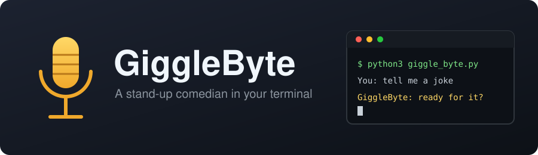

<p align="center">
  
</p>

# GiggleByte CLI Chatbot


GiggleByte is a command-line chatbot with a stand-up comedian personality. It is built with Python and the OpenAI SDK, and runs on a local Llama 3.1 model through Ollama with real-time streaming responses and tool (function) calling.

## Features

- **Stand-up comedian persona:** Answers include puns, humorous analogies, and a lighthearted tone.
- **Conversational memory:** Context is preserved across turns, so conversations flow naturally.
- **Streaming responses:** Replies appear in the terminal in real time as the model generates them.
- **Tool calling:** The model can call Python functions to get information it cannot know on its own, such as the current date and time.
- **Fully local and private:** Everything runs on your machine through Ollama. No data leaves your device and no API key is required.

## Available Tools

| Tool | Description |
|------|-------------|
| `get_current_datetime` | Returns the current local date, time, and day of the week |

## Project Structure

```
giggle_byte/
├── giggle_byte.py      # Main chat loop and tool-call handling
├── spinner.py          # Terminal loading indicator
├── tools/
│   ├── __init__.py     # Tool registry and run_tool dispatcher
│   └── time_tools.py   # Date and time tools
├── assets/
│   └── banner.svg
└── README.md
```

## Prerequisites

- Python 3
- [Ollama](https://ollama.com/) installed and running locally
- The Llama 3.1 model pulled in Ollama

To download and start the model:

```bash
ollama run llama3.1
```

## Installation

1. Clone the repository:

```bash
git clone https://github.com/YOUR-USERNAME/giggle_byte.git
cd giggle_byte
```

2. Create and activate a virtual environment (recommended):

```bash
python3 -m venv .venv
source .venv/bin/activate   # On Windows: .venv\Scripts\activate
```

3. Install dependencies:

```bash
pip install openai
```

## Usage

Make sure Ollama is running, then start the chatbot from the project folder:

```bash
python3 giggle_byte.py
```

Type your questions at the prompt and GiggleByte will respond in character. Type `exit` to quit.

Try asking "What is today's date?" to see a tool call in action.

## How Tool Calling Works

1. The chat loop sends the conversation to the model along with the list of available tool schemas.
2. If the model needs a tool, it replies with a tool request instead of a final answer.
3. The `run_tool` dispatcher in `tools/__init__.py` looks up the requested function by name, runs it, and returns the result as text.
4. The result is added to the conversation, and the model writes its final answer using that information.

## Adding a New Tool

1. Create a module in `tools/` (for example, `notes_tools.py`) containing the function, its schema, and a name-to-function lookup dictionary, following the pattern in `time_tools.py`.
2. Import the module and add it to the module list in `tools/__init__.py`.

The main chat loop does not need to change.

## Tech Stack

- Python
- OpenAI SDK (used as a client for Ollama's OpenAI-compatible API)
- Ollama
- Llama 3.1
